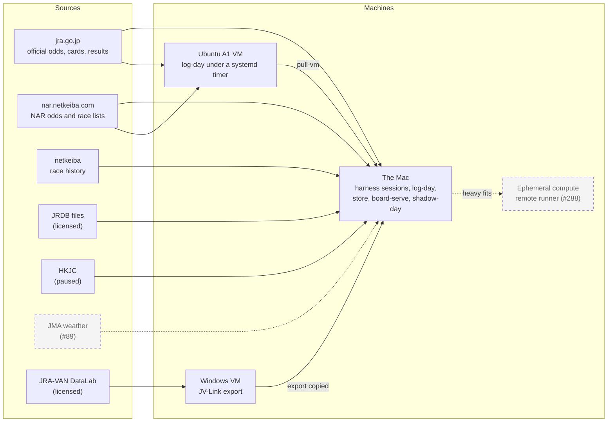
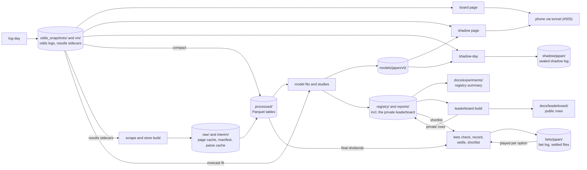
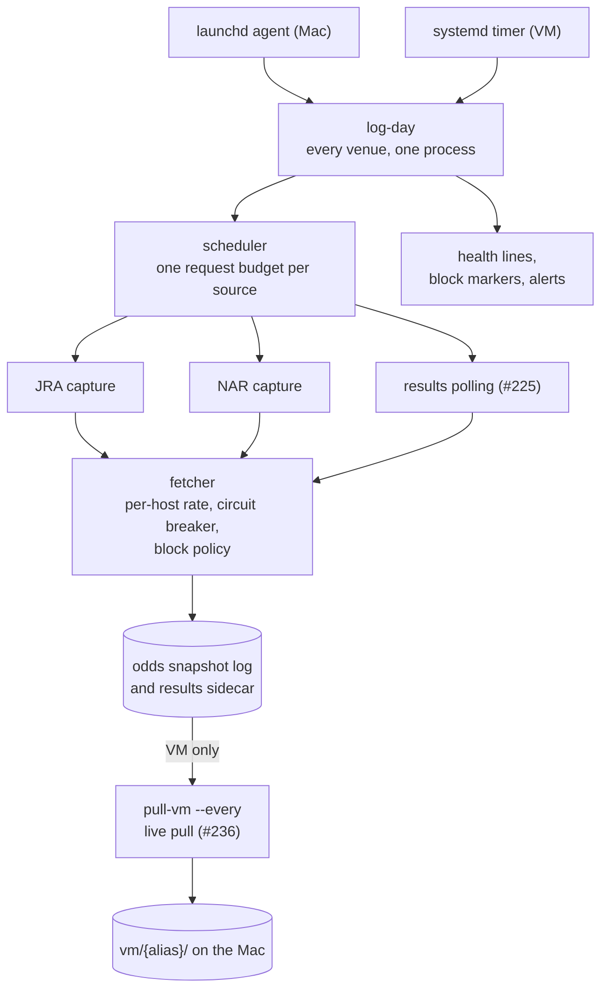
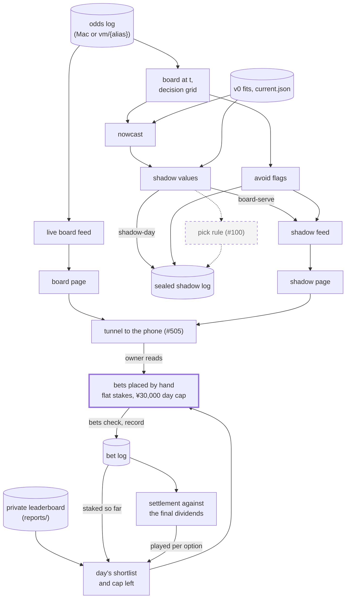
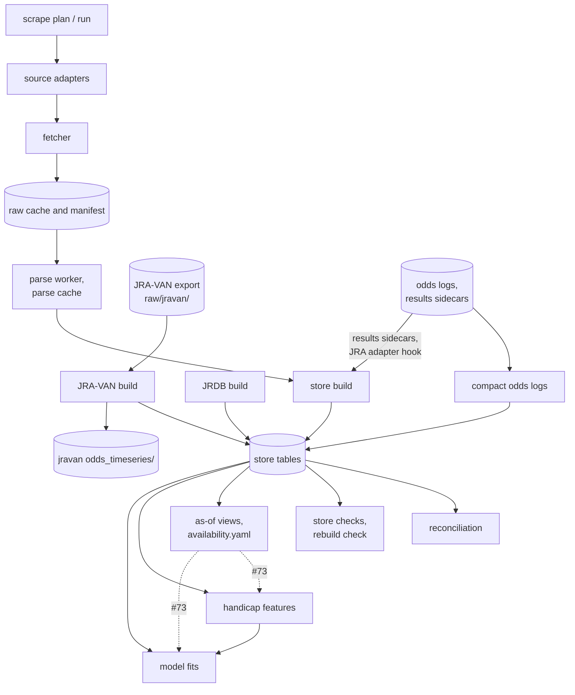
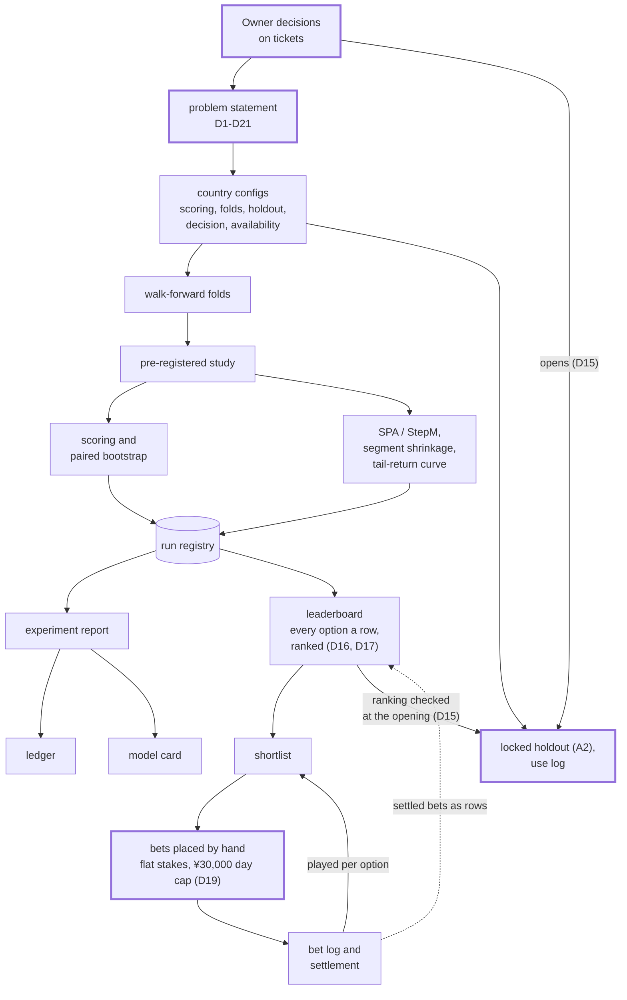
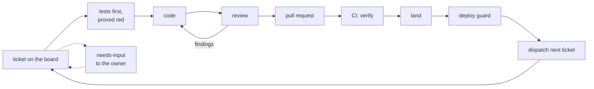

# Architecture

How the moving pieces fit, in five views. Each diagram is followed by a legend that names the code
behind each box. Paths are relative to `src/horsetrack/` unless they start with `scripts/`, `docs/`
or `.github/`.

Conventions in every diagram:
- A solid box is built: its legend entry names the module or script on `main`.
- A dashed grey box (class `planned`) is not built yet. It carries the ticket that builds it and no
  module path. A dashed arrow is a flow that does not run yet.
- A thick-bordered box (class `owner`) is an owner decision: nothing downstream of it moves without
  the owner's answer on a ticket.

Simplified diagrams of the models themselves, in six views from the decision to the race-day
timeline, are in [docs/modeling.md](modeling.md); view 4 here stays at the level of the evaluation
harness and governance.

When an epic changes one of these flows, its last ticket updates this file.

## 1. System overview

### 1a. Sources and machines

| Box | Code |
| --- | --- |
| jra.go.jp | `countries/japan/jra/capture.py`, `countries/japan/jra/official_pages.py`, `countries/japan/jra/official_card.py`, `countries/japan/jra/exotic_pages.py`, `countries/japan/jra/going.py`; config `countries/japan/config/jra.yaml` |
| nar.netkeiba.com | `countries/japan/nar/capture.py`, `countries/japan/nar/pages.py`; config `countries/japan/config/nar.yaml`; research `docs/research/nar-data-access.md` |
| netkeiba | `countries/japan/jra/netkeiba/` (parsers and `countries/japan/jra/netkeiba/urls.py`), driven by `countries/japan/jra/adapter.py` |
| JRDB files | `countries/japan/jrdb/parse.py`, `countries/japan/jrdb/join.py`, `countries/japan/jrdb/pedigree.py`, `countries/japan/jrdb/tables.py`; field specs and data stay under the data dir |
| HKJC | `countries/hongkong/hkjc/adapter.py` and the parsers beside it; config `countries/hongkong/config/hkjc.yaml` |
| JMA weather | planned, #89 |
| JRA-VAN DataLab, Windows VM | the export is made by JV-Link on the Windows VM (#196; no repository code runs there; research `docs/research/jravan-cloud-windows.md`) and copied to `raw/jravan/` on the Mac; the parsers are `countries/japan/jravan/` (view 3); spec `docs/specs/jravan.md` |
| The Mac | the CLI `cli.py` (`horsetrack ...`); every request goes through `core/ingest/fetcher.py`; the LaunchAgent `countries/japan/logger/launchd.py` |
| Ubuntu A1 VM | set up by `scripts/vm_setup.sh`; units from `countries/japan/logger/systemd.py`; its trial run is #223 |
| pull-vm | `countries/japan/logger/pull_vm.py` (nightly, and live with `--every`, #236) |
| Ephemeral compute | planned, epic #288 (#292, #293, #295) |

### 1b. Stores and outputs

Everything below lives under `$HORSETRACK_DATA_DIR`, outside the repository (`core/paths.py`,
`core/env.py`, `.env.example`). Only the committed registry summary, the public leaderboard and the
reports that carry no licensed-source output are in git. The bet log is the owner's financial
record and never leaves the data dir.

| Folder or box | Written by | Read by |
| --- | --- | --- |
| `raw/{source}/` (pages, `manifest.sqlite`) | `core/ingest/fetcher.py`, `core/ingest/queue.py`; the one-time HKTrack copy `scripts/port_hktrack_data.py` | `core/store/build.py` |
| `raw/jravan/` (the JV-Data export: `stored/`, `timeseries/`, its `README.md` and `manifest.json`; #196) | copied from the Windows VM; no code in the repository writes it | the `countries/japan/jravan/` parsers; `countries/japan/jravan/check.py` checks it against the workbook |
| `specs/jravan/` (the JV-Data specification workbook) | placed by the owner | `countries/japan/jravan/spec.py`, at run time, so no layout is in the repository |
| `interim/{source}/` (parse cache) | `core/store/cache.py` | `core/store/build.py` |
| `interim/jravan/records/` (the dump: one Parquet file per file of each unmapped JV-Data family, and `_dump.json`) | `countries/japan/jravan/dump.py` (`horsetrack japan jravan dump`) | the coverage audit `countries/japan/research/coverage.py`; no model |
| `processed/{source}/` | `core/store/build.py`, `countries/japan/jrdb/tables.py`, `countries/japan/logger/compact.py` (`odds_timeseries/`); for `jravan`, `countries/japan/jravan/{races,runners,dividends,odds,votes,masters,bloodlines,timeseries}.py` | `core/store/tables.py`, `core/store/asof.py`, the model fits (`countries/japan/models/v0/store.py` takes the source); `countries/japan/jravan/reconcile.py` |
| `odds_snapshots/{source}/{date}/` | `countries/japan/odds_log.py` from log-day | `countries/japan/board/`, `countries/japan/shadow/day.py`; `countries/japan/logger/compact.py` (into `processed/jra/odds_timeseries/`); `countries/japan/jra/adapter.py` (`_logged_results`: the #225 results sidecars, so the store build fills `races.result_published_utc`); `countries/japan/models/v0/nowcast.py` (`training_examples` fits from it); `countries/japan/logger/compare.py` (the HKTrack cutover comparison) |
| `vm/{alias}/` | `countries/japan/logger/pull_vm.py` | `board-serve` and `shadow-day` with `--from-vm` |
| `logs/japan/` | log-day's health lines and block markers (`countries/japan/logger/health.py`, `countries/japan/logger/log_day.py`) | the owner |
| `models/japan/v0/` | `countries/japan/models/v0/calibration.py`, `countries/japan/models/v0/nowcast.py`, `countries/japan/models/v0/ordering.py`, `countries/japan/models/v0/residual.py` | `countries/japan/models/v0/loader.py` |
| `shadow/japan/{date}.jsonl` | `countries/japan/shadow/log.py` (also through `log_decisions` in `countries/japan/models/shadow.py`) | `countries/japan/models/shadow.py` (`read_shadow`, development days only, then `settle_shadow` against the final dividends, #101); the shadow page never reads it |
| `registry/{country}.jsonl` | `core/eval/registry.py`, from the studies and fits | its committed summary `docs/experiments/registry/japan/`; `countries/japan/research/leaderboard_build.py` (the leaderboard rows) |
| `reports/` | `core/eval/reports.py` (`write_report`), `core/store/checks.py` | the owner |
| `reports/candidate-cells/` | the studies, in the candidate-cell schema (#430), e.g. `countries/japan/research/exacta_ceiling.py` | `countries/japan/research/leaderboard_build.py` |
| `reports/leaderboard-japan.{md,json}` (the private leaderboard, withheld figures included) | `countries/japan/research/leaderboard_build.py` (`horsetrack japan leaderboard`), through `core/eval/leaderboard.py` (`write_leaderboard`) | the owner; `countries/japan/bets/shortlist.py` rebuilds the rows itself and writes no file |
| `docs/leaderboard/japan.md` (in git) | `horsetrack japan leaderboard --public`: the public rows, withheld rows listed by id only (D21) | the owner |
| `bets/japan/{date}.jsonl` | `countries/japan/bets/log.py` (`horsetrack japan bets record`), hash-chained, one file per race day; spec `docs/specs/bet-log.md` | `countries/japan/bets/cli.py` (`check`, `settle`, `shortlist`) |
| `bets/japan/{date}.settled.json` | `countries/japan/bets/cli.py` (`bets settle`), from `countries/japan/bets/settle.py` | `countries/japan/bets/shortlist.py` (what was played on each option) |
| `features/`, `jrdb/`, `fixtures/` | `countries/japan/handicap/` feature sets; JRDB specs; real pages for `local` tests | the fits; `countries/japan/jrdb/parse.py`; the `local` tests |
| board page, shadow page | `countries/japan/board/server.py` (`board-serve`, bound to localhost), `countries/japan/board/web/` | the owner's browser |
| phone via tunnel | `countries/japan/board/tunnel.py` (`board-serve --tunnel`: a cloudflared quick tunnel, every path behind a per-run access token in `board/access-token`; docs/specs/board-feed.md) | the owner's phone |

## 2. Race-day data flow

### 2a. Logging the odds

| Box | Code |
| --- | --- |
| launchd agent, systemd timer | `countries/japan/logger/launchd.py`, `countries/japan/logger/systemd.py` (both start `log-day --unattended` every 30 minutes) |
| log-day | `countries/japan/logger/log_day.py` (lock, per-source sites, block handling, alerts) |
| scheduler | `countries/japan/logger/schedule.py`; config `countries/japan/config/logger.yaml` |
| fetcher | `core/ingest/fetcher.py` (cache-first, per-host rate and breaker, block pages quarantined) |
| JRA capture, NAR capture | `countries/japan/jra/capture.py`, `countries/japan/nar/capture.py` |
| results polling | `countries/japan/logger/schedule.py` with logger.yaml's `results` block, `countries/japan/jra/capture.py` |
| odds snapshot log | `countries/japan/odds_log.py`; spec `docs/specs/odds-log.md` |
| health lines | `countries/japan/logger/health.py` |
| pull-vm | `countries/japan/logger/pull_vm.py` |

### 2b. From the board at t to the phone and the bet log

| Box | Code |
| --- | --- |
| board at t, decision grid | `countries/japan/board/snapshot.py`; grid in `countries/japan/config/decision.yaml` (D2); spec `docs/specs/board-at-t.md` |
| live board feed, board page | `countries/japan/board/feed.py`, `countries/japan/board/server.py`, `countries/japan/board/web/board.html`, `countries/japan/board/web/board.js`; spec `docs/specs/board-feed.md` |
| v0 fits | `countries/japan/models/v0/loader.py` reads them |
| nowcast | `countries/japan/models/v0/nowcast.py`; config `countries/japan/config/nowcast_v0.yaml` |
| shadow values | `countries/japan/models/v0/shadow_values.py` (with `countries/japan/models/v0/calibration.py`, `countries/japan/models/v0/ordering.py`, `countries/japan/models/v0/residual.py`) |
| avoid flags | `countries/japan/board/flags.py`; config `countries/japan/config/avoid_flags.yaml` |
| pick rule | shadow EV in `countries/japan/models/decision.py` (#100); settled, staked flat under the cap and scored on paper in `countries/japan/models/shadow.py`, run by `countries/japan/studies/shadow_run.py` (#101) |
| sealed shadow log | `countries/japan/shadow/log.py`, written by `shadow-day` in `countries/japan/shadow/day.py`; spec `docs/specs/shadow-log.md` |
| shadow feed, shadow page | `countries/japan/board/shadow_feed.py`, `countries/japan/board/server.py`, `countries/japan/board/web/shadow.html`, `countries/japan/board/web/shadow.js` |
| tunnel to the phone | `countries/japan/board/tunnel.py`, started by `board-serve --tunnel` (`countries/japan/board/server.py` gates every path with the run's access token); spec `docs/specs/board-feed.md` |
| private leaderboard | `reports/leaderboard-japan.{md,json}` under the data dir, written by `countries/japan/research/leaderboard_build.py` (`horsetrack japan leaderboard`); spec `docs/specs/leaderboard.md` (view 4) |
| day's shortlist and cap left | `countries/japan/bets/shortlist.py`, run as `horsetrack japan bets shortlist --date D` (`countries/japan/bets/cli.py`): the top-ranked, measured options with their CI, the variants searched, a `[look-ahead]` label where the selection reads a later board, the day's staked total and the cap left; terminal only, nothing written (D21) |
| bets placed by hand | the owner, on the betting site; no code logs in to a betting account or places a bet. Flat stake and the ¥30,000 race-day cap are the owner's, set in `countries/japan/config/betting.yaml` |
| bet log | `countries/japan/bets/log.py` (`BetLog`, `bets check` and `bets record`; `bet_log_path`, `load_limits`), `$HORSETRACK_DATA_DIR/bets/japan/{date}.jsonl`; spec `docs/specs/bet-log.md` |
| settlement | `countries/japan/bets/settle.py`, `bets settle --date D`, into `{date}.settled.json`; a holdout day's bets are labelled `holdout` and not settled (`is_holdout_day`, `core/eval/holdout.py`) |

The shortlist is a terminal listing, not a feed: the shadow page and the phone do not show it. The
settled file feeds back only into the shortlist's "played" line; turning settled bets into
leaderboard rows is not built.

Two processes compute shadow values from the same odds log and fits: `shadow-day` seals them into the
shadow log, and `board-serve` recomputes them for the shadow feed, which never reads the log. Both read
the VM's pulled copy with `--from-vm`.

## 3. History and store flow

| Box | Code |
| --- | --- |
| scrape plan / run | `core/ingest/cli.py` (`horsetrack scrape ...`), `core/ingest/runner.py`, `core/ingest/queue.py` |
| source adapters | `core/ingest/adapters.py` (contract and registry), `countries/japan/jra/adapter.py`, `countries/hongkong/hkjc/adapter.py` |
| fetcher | `core/ingest/fetcher.py` |
| parse worker, parse cache | `core/store/parse_worker.py`, `core/store/cache.py` |
| store build | `core/store/build.py`, `core/store/cli.py` (`horsetrack store ...`); spec `docs/specs/store.md` |
| JRDB build | `countries/japan/jrdb/tables.py` (`horsetrack japan jrdb build`) |
| JRA-VAN export, JRA-VAN build | `countries/japan/jravan/` (`horsetrack japan jravan ...`): `races.py`, `runners.py`, `dividends.py`, `odds.py` (`final-odds`), `votes.py`, `masters.py`, `bloodlines.py`, `timeseries.py`, with `check.py` and `dump.py`, over `records.py`, `keys.py` and `spec.py`. It reads `raw/jravan/` and writes the `jravan` source's tables under `processed/jravan/`; spec `docs/specs/jravan.md` |
| jravan odds_timeseries/ | `countries/japan/jravan/timeseries.py`, in the odds log's own schema (`countries/japan/logger/compact.py`), into `processed/jravan/odds_timeseries/` |
| reconciliation | `countries/japan/jravan/reconcile.py` (`horsetrack japan jravan reconcile`): the jravan and `jra` (netkeiba) stores compared race by race, runner by runner and dividend by dividend; its detail goes through `write_report` |
| odds logs, results sidecars | `odds_snapshots/{source}/{date}/` from log-day (view 2a); the store build reads the sidecars through `countries/japan/jra/adapter.py` (`result_published_utc()`, `result_unpublished_utc()`) |
| compact odds logs | `countries/japan/logger/compact.py` (`horsetrack japan compact`), into `processed/jra/odds_timeseries/` |
| store tables | `core/store/schemas.py`, `core/store/tables.py`; one set per source key (`jra`, `nar`, `hkjc`, `jravan`; `docs/specs/store.md`) |
| store checks, rebuild check | `core/store/checks.py`, `scripts/check_store_rebuild.py` |
| as-of views | `core/store/asof.py`, `countries/japan/config/availability.yaml` (owner decisions); spec `docs/specs/as-of.md` |
| handicap features | `countries/japan/handicap/pp.py`, `countries/japan/handicap/factors.py`, `countries/japan/handicap/workouts.py`, `countries/japan/handicap/workouts_jravan.py`, `countries/japan/handicap/track_bias.py` |
| model fits | `countries/japan/models/v0/` (scoped reader `countries/japan/models/v0/store.py`), `countries/japan/studies/calibration.py` |

The as-of views exist, but the features and fits do not read through them yet; the dashed arrows are
that wiring, under the model-stack epic #73.

The JRA-VAN build is a second path into the store, under its own source key `jravan`: it reads the
export that is already on the Mac instead of fetching pages, so it has no fetcher, no manifest and
no parse cache. Its tables are read through the same readers, the same availability rules and the
same holdout and D10 guards as the netkeiba (`jra`) store; no model reads them yet. Its JRA races
are reconciled with the netkeiba store (the reconciliation box), and `docs/data-coverage.md` states
per model input which source and table supplies it.

## 4. Governance and evaluation

| Box | Code or document |
| --- | --- |
| Owner decisions | answers on `needs-input` tickets; never a `Ruling:` (see CLAUDE.md, "Modeling governance") |
| problem statement | `docs/problem-statement.md` (D1-D21, signed) |
| country configs | `countries/japan/config/scoring.yaml` (D6, D7), `countries/japan/config/folds.yaml` (D9), `countries/japan/config/holdout.yaml` (D11, D12), `countries/japan/config/decision.yaml` (D2), `countries/japan/config/availability.yaml` (#80); read through `core/config.py` |
| locked holdout | `core/eval/holdout.py` (`LockedHoldout.open`, `split_off`); every use appends a line to the country's `holdout_log.jsonl`, committed with the PR (the first opening creates it) |
| walk-forward folds | `core/eval/folds.py` |
| pre-registered study | e.g. `countries/japan/studies/calibration.py` |
| scoring and paired bootstrap | `core/eval/scoring.py`, `core/eval/bootstrap.py` |
| SPA / StepM, segment shrinkage, tail-return curve | `core/eval/snooping.py`, `core/eval/segment_roi.py` (D17); `core/eval/tail.py` (realised return by claim quantile band, meeting bootstrap, D7) |
| run registry | `core/eval/registry.py`; summary `docs/experiments/registry/japan/` |
| experiment report | template `docs/experiment-report.md`; reports in `docs/experiments/`; licensed-source outputs through `core/eval/reports.py` into the data dir |
| ledger | `docs/ledger.md` |
| leaderboard | `core/eval/leaderboard.py` (rows, shrinkage within a pool, ranking, writers; `rows_from_registry`); `countries/japan/research/leaderboard_build.py` (`horsetrack japan leaderboard`: the registry and the candidate-cell files into the private leaderboard under the data dir and, with `--public`, `docs/leaderboard/japan.md`); `countries/japan/research/leaderboard_backfill.py` (the legacy families); spec `docs/specs/leaderboard.md` |
| shortlist | `countries/japan/bets/shortlist.py` (`horsetrack japan bets shortlist`; view 2b) |
| bets placed by hand | the owner; no code places a bet. Flat stake and cap: `countries/japan/config/betting.yaml`, checked and flagged, never blocked, by `countries/japan/bets/log.py` |
| bet log and settlement | `countries/japan/bets/log.py`, `countries/japan/bets/settle.py`, `countries/japan/bets/cli.py`; spec `docs/specs/bet-log.md` (view 2b). The dashed arrow is not built: settlement feeds only the shortlist's "played" line today |
| model card | `countries/japan/MODEL_CARD.md`, `countries/hongkong/MODEL_CARD.md` |

Nothing is adopted or rejected (D16 as amended 2026-11-27, epic #447): the leaderboard ranks every
option and the top-ranked are played by hand. The owner gates three places: the problem statement
and the configs that encode it, every holdout opening (a check on whether the ranking holds, not a
pass or fail), and staking, which is the flat stakes, the ¥30,000 race-day cap and every bet placed
by hand.

## 5. Harness workflow

| Box | Code |
| --- | --- |
| ticket, tests, code, review, land, dispatch | the harness tooling outside this repository (`harness-board`, `harness-red`, `harness-pr`, `/harness:work`); templates `.github/ISSUE_TEMPLATE/`, `.github/pull_request_template.md` |
| commit and push guards | `.githooks/pre-commit`, `.githooks/pre-push`, `.githooks/pre-merge-commit` |
| CI: verify | `.github/workflows/ci.yml` runs `scripts/verify.sh`; the public-tree guard `scripts/check_public_tree.py` |
| deploy guard | `.github/workflows/deploy.yml` runs `scripts/deploy_guard.py` and the smoke check `scripts/smoke.sh` |
