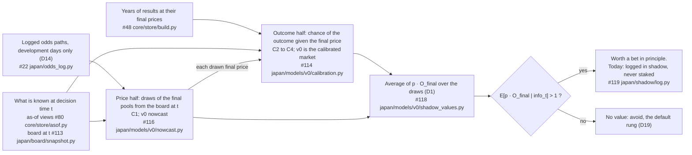
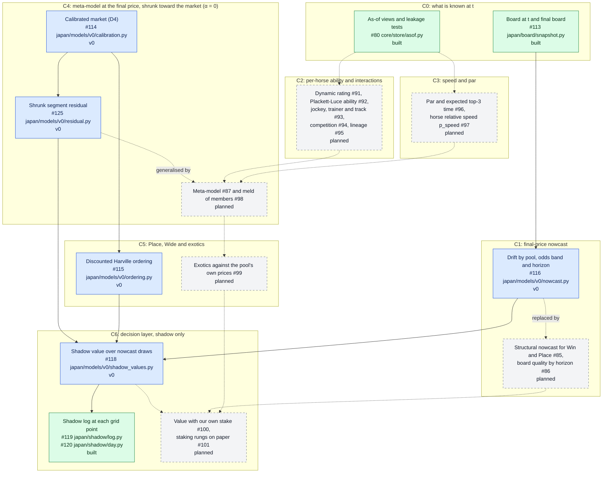
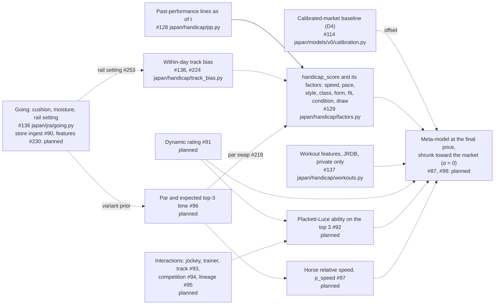
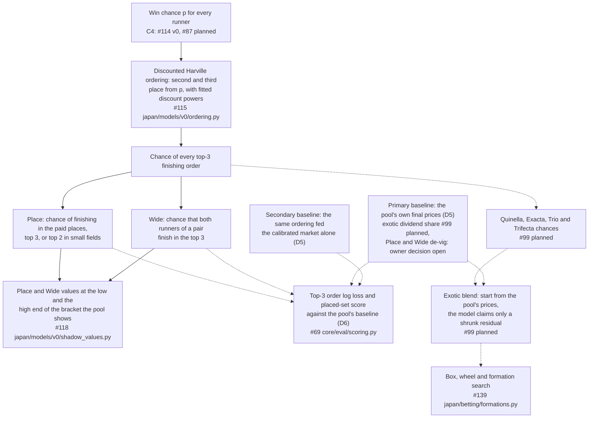
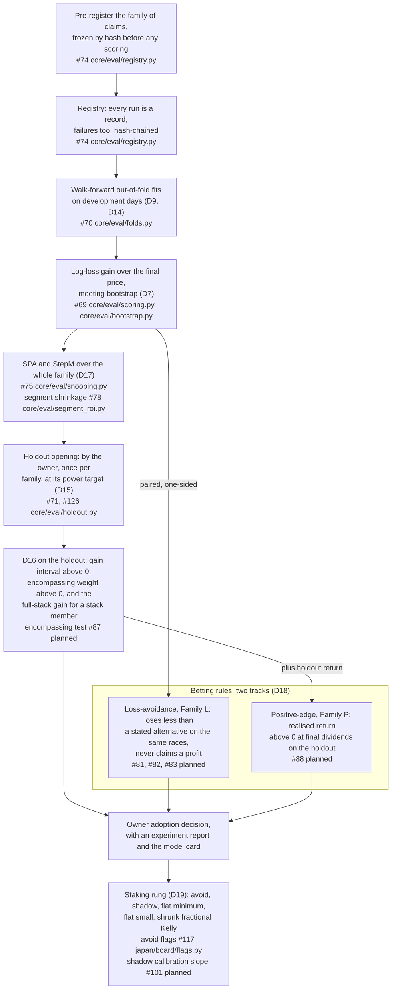
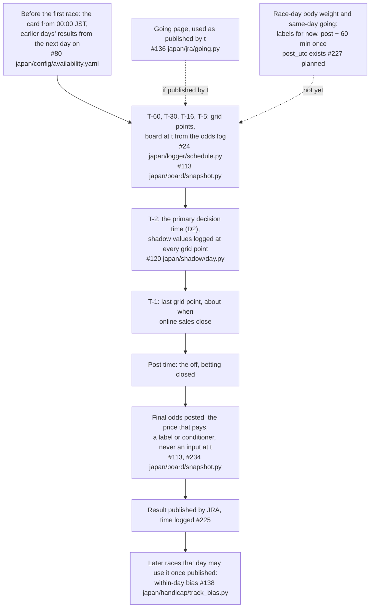

# Modeling, in six diagrams

Simplified pictures of the modeling, so the moving pieces are easy to point at. They describe
structure only: no result, figure or performance number appears here (D21 keeps licensed-source
figures out of the repository, and results belong in experiment reports and the registry). The
decisions D1 to D21 are in [the problem statement](problem-statement.md); the claims behind them are
in [the ledger](ledger.md). The system around the models (logger, store, board) is in
[the architecture](architecture.md).

How to read the diagrams:
- Every box names its ticket. A box built on main also names its module, with two short prefixes:
  `japan/` is `src/horsetrack/countries/japan/` and `core/` is `src/horsetrack/core/`. A box whose
  code is not on main says "planned".
- In diagram 2, the tag in each box gives its status: `v0` is the simple first version running in
  shadow now, `built` is another piece on main, `planned` is a ticket not yet landed. Blue, green
  and dashed grey boxes match the tags.
- A solid arrow is a data flow that exists in code on main; a dotted arrow is one a ticket plans.
- Nothing here is adopted. Every model and rule stays in shadow until the owner adopts it through
  diagram 5, and no code places a bet.

Status as of 2026-11-25. When a ticket in a diagram lands, move its box from planned to built and
name its module.

## 1. The decision in one picture

A bet pays the final odds, which nobody knows until betting closes, so a bet is worth making only
when its chance of winning times the final price is, on average, more than the stake. The chance
comes from models trained on years of results at the price that actually paid; the final price
comes from a forecast, the nowcast, of how the odds will move between now and the close. For each
simulated final price the chance is worked out again and multiplied by that price, and only then
averaged, so a horse whose price tends to shorten when it is going to win is not overvalued
(decision D1).

## 2. The model stack, C0 to C6

The work is split into seven layers, and each is tested both on its own and for what it adds
against the final price. C0 makes sure every model sees only what was known at the decision time;
C1 forecasts the final price; C2 and C3 describe the horses and the race; C4 combines them with the
market, starting from the market alone so that every member has to earn its weight; C5 turns Win
chances into Place, Wide and exotic chances; C6 turns chances and price forecasts into values,
which are logged in shadow and never bet. The v0 boxes are deliberately simple versions that let
the whole chain run end to end on race days while the planned layers are built (epic #73).

## 3. Members feeding the meta-model

The meta-model is where everything known about the horses meets the market's own view, the final
price. Each box on the left is a member or a set of features, and an arrow means its output is an
input of the box it points to; today only the past-performance lines feeding the handicap factors
run in code, and every other flow is planned. The meta-model starts from the calibrated market and
gives a member weight only when it improves on the final price, so a member that adds nothing ends
up with no weight. Members built on the licensed JRDB data, such as the workout features, run only
in private models on the owner's machine and never publish a figure (D21).

## 4. From Win to Place, Wide and exotics

Place and Wide pay when a horse finishes near the front, so their chances come from the chance of
every possible top-3 finish, not from the Win chance alone. The ordering model builds those from the
Win chances and adds them up into the chance of each horse placing and of each pair landing in the
top 3. Before the race the pool shows Place and Wide odds as a range, because the payout depends on
which other horses also place, so v0 gives a value at both ends of that range. Every claim in these
pools is judged first against the pool's own final prices and only second against the Win-derived
ordering (D5, D6).

## 5. How a claim earns adoption

A model or a betting rule is adopted only by the owner, and only after it survives a fixed
sequence of tests written down before the data is looked at. Every attempt is recorded, failures
included, so the number of things tried is always known and the tests can allow for it. Models are
fitted and scored on development days; the locked holdout days are opened by the owner once per
pre-registered family, and a model must beat the final price there with an interval above zero.
Rules that only avoid losses need to lose less than a stated alternative on the same races, rules
that claim a profit must also make money at the final dividends on the holdout, and either kind
climbs the staking rungs one at a time, starting from avoid (D18, D19).

## 6. Timeline of a race day

Through a race day the odds are captured on a fixed grid of minutes before the off, and at each
grid point the models may use only what had been published by then (the rule for every table is in
[the as-of spec](specs/as-of.md)). T-2 is the main decision time and T-1 is about the last moment a
bet could be placed; the price that actually pays appears only after the off, so before then it can
only be forecast. A race's result can feed later races the same day, for example through the
within-day track bias, but only once JRA has published it.
