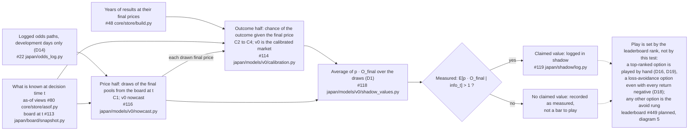
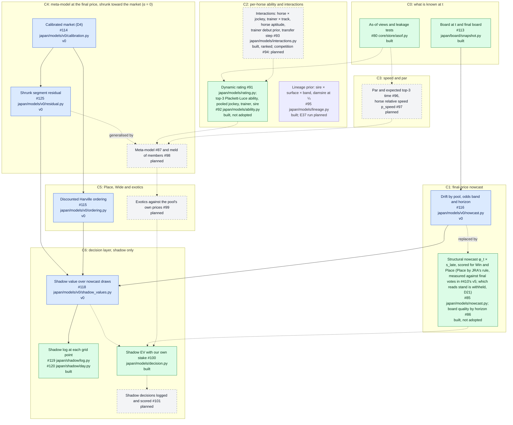
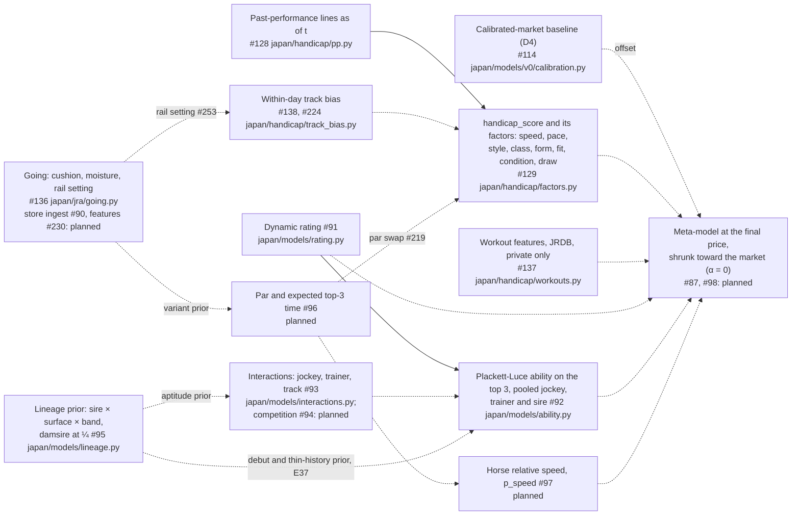
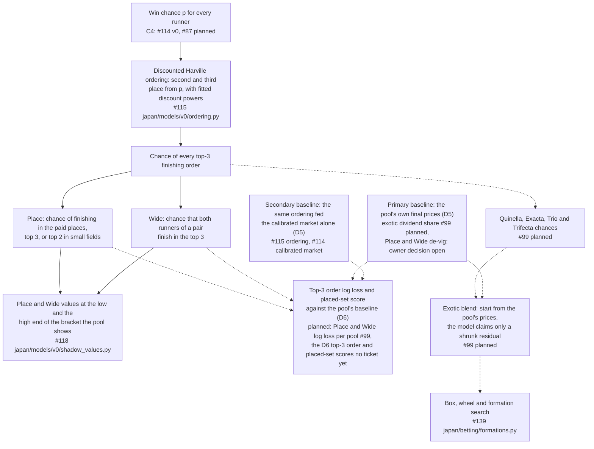
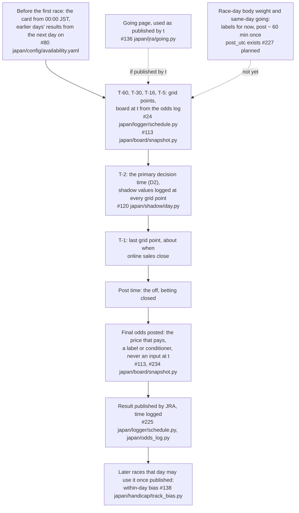

# Modeling, in six diagrams

Simplified pictures of the modeling, so the moving pieces are easy to point at. They describe
structure only: no result, figure or performance number appears here (D21 keeps licensed-source
figures out of the repository, and results belong in experiment reports and the registry). The
decisions D1 to D21 are in [the problem statement](problem-statement.md); the claims behind them are
in [the ledger](ledger.md). The system around the models (logger, store, board) is in
[the architecture](architecture.md). Which source and table supplies each input of these diagrams,
over which dates, and where the gaps are, each with its ticket, is in
[the data coverage](data-coverage.md) (generated by `horsetrack japan coverage --write-doc`).

How to read the diagrams:
- A box that stands for code or a ticket names its ticket; a box that only explains an idea (a
  quantity, a test, a moment in the day) does not. A box built on main also names its module, with two short prefixes:
  `japan/` is `src/horsetrack/countries/japan/` and `core/` is `src/horsetrack/core/`. A box whose
  code is not on main says "planned".
- In diagram 2, the tag in each box gives its status: `v0` is the simple first version running in
  shadow now, `built` is another piece on main, `planned` is a ticket not yet landed. Blue, green
  and dashed grey boxes match the tags.
- In diagrams 1 to 4, a solid arrow is a data flow that exists in code on main and a dotted arrow
  is one a ticket plans. Diagrams 5 and 6 show the order of steps, in a process and in a race day:
  there a solid arrow is a step in that order, and a dotted arrow leads into a step that is planned,
  not yet available, or still waiting on an owner decision.
- Nothing here is adopted or rejected (D16 as amended 2026-11-27, epic #447). Every option, model
  and member is a row on the country's leaderboard, ranked by its return at the final price
  (diagram 5); the top-ranked options are shadowed and played by hand with small flat stakes, and no
  code places a bet.

Status as of 2026-11-27. When a ticket in a diagram lands, move its box from planned to built and
name its module.

## 1. The decision in one picture

A bet pays the final odds, which nobody knows until betting closes, so a bet has positive value only
when its chance of winning times the final price is, on average, more than the stake. That test is a
measurement; whether an option is played is set by its rank on the leaderboard (diagram 5). The chance
comes from models trained on years of results at the price that actually paid; the final price
comes from a forecast, the nowcast, of how the odds will move between now and the close. For each
simulated final price the chance is worked out again and multiplied by that price, and only then
averaged, so a horse whose price tends to shorten when it is going to win is not overvalued
(decision D1).

## 2. The model stack, C0 to C6

The work is split into seven layers, and each is tested both on its own and for what it adds
against the final price. C0 makes sure every model sees only what was known at the decision time;
C1 forecasts the final price; C2 and C3 describe the horses and the race; C4 combines them with the
market, starting from the market alone so that every member has to earn its weight; C5 turns Win
chances into Place, Wide and exotic chances; C6 turns chances and price forecasts into values,
which are logged in shadow and never bet. The v0 boxes are deliberately simple versions that let
the whole chain run end to end on race days while the planned layers are built (epic #73).

## 3. Members feeding the meta-model

The meta-model is where everything known about the horses meets the market's own view, the final
price. Each box on the left is a member or a set of features, and an arrow means its output is an
input of the box it points to; today the past-performance lines feeding the handicap factors and
the dynamic rating feeding the Plackett-Luce ability (#92's study) run in code, and every other
flow is planned. The ability model's sire comes from the JRA-VAN pedigree, so its results are
withheld (D21). The meta-model starts from the calibrated market and
gives a member weight only when it improves on the final price, so a member that adds nothing ends
up with no weight. Members built on the licensed JRDB data, such as the workout features, run only
in private models on the owner's machine and never publish a figure (D21).

## 4. From Win to Place, Wide and exotics

Place and Wide pay when a horse finishes near the front, so their chances come from the chance of
every possible top-3 finish, not from the Win chance alone. The ordering model builds those from the
Win chances and adds them up into the chance of each horse placing and of each pair landing in the
top 3. Before the race the pool shows Place and Wide odds as a range, because the payout depends on
which other horses also place, so v0 gives a value at both ends of that range. Every claim in these
pools is judged first against the pool's own final prices and only second against the Win-derived
ordering (D5, D6).

## 5. How an option is ranked

```mermaid
flowchart TD
    PRE["Pre-register the study: Claude freezes its spec<br/>by hash before any scored read, no sign-off wait<br/>#74 core/eval/registry.py"]
    REG["Registry: every run is a record,<br/>failures too, hash-chained<br/>#74 core/eval/registry.py"]
    OOF["Walk-forward out-of-fold fits<br/>on development days (D9, D14)<br/>#70 core/eval/folds.py"]
    RET["Return per ¥100 at the final dividend,<br/>takeout and breakage included,<br/>with its meeting-bootstrap CI (D7)<br/>#69 core/eval/bootstrap.py;<br/>read from every record: #450 planned"]
    SHRINK["Shrinkage of the ranking (D17):<br/>hierarchical within a study #78 core/eval/segment_roi.py,<br/>per pool across studies #449 planned"]
    LB["Leaderboard: every option, model and member a row,<br/>failed variants too, with its CI and the<br/>number of variants searched (D16)<br/>#449 core/eval/leaderboard.py planned;<br/>horsetrack japan leaderboard and<br/>docs/leaderboard/japan.md #452 planned"]
    SEL{"Top-ranked row: is every selection input<br/>available at the decision time t it is played at<br/>(D2 grid, T-2 primary; as-of views, board at t)?<br/>#455 planned"}
    PROXY["Look-ahead row (a selection input from after t,<br/>such as the final price or a later board): played<br/>only through its board-at-t proxy, labelled as such,<br/>else left off the shortlist (D16, D19)<br/>labels #455 planned"]
    PLAY["Top-ranked options: shadowed, and played by hand<br/>with flat stakes, at most ¥30,000 per race day (D19)<br/>shadow log #119 japan/shadow/log.py;<br/>the day's shortlist #455 planned"]
    BETS["Bet log, every hand-placed bet, logged and<br/>counted toward the day cap, holdout days too<br/>#453 japan/bets/ planned"]
    DAY{"Holdout day? (D14)<br/>is_holdout_day #71 core/eval/holdout.py;<br/>wired into settlement #454 planned"}
    SETTLE["Development day: settled against<br/>the final dividends<br/>#454 planned"]
    DEFER["Holdout day: not settled at routine settlement;<br/>settled only at the owner's opening (D15,<br/>LockedHoldout.open), its results kept out of<br/>the development ranking (D14)<br/>#454 planned, core/eval/holdout.py"]
    HOLD["Holdout opening by the owner (D15), once per family<br/>at its power target: checks whether the ranking<br/>holds up, adopts or rejects nothing<br/>#71, #126 core/eval/holdout.py"]
    DIAG["Reported diagnostics, gating nothing:<br/>log-loss gain over the final price #69 core/eval/scoring.py,<br/>encompassing weight #87 planned,<br/>SPA and StepM #75 core/eval/snooping.py,<br/>tail-return curve #433 core/eval/tail.py"]
    PRE --> REG
    REG --> OOF
    OOF --> RET
    OOF --> DIAG
    RET --> SHRINK
    SHRINK -.-> LB
    DIAG -.->|"beside the row"| LB
    LB -.-> SEL
    SEL -.->|"yes: decision-time"| PLAY
    SEL -.->|"no: look-ahead"| PROXY
    PROXY -.->|"proxy at t"| PLAY
    PLAY -.-> BETS
    BETS -.-> DAY
    DAY -.->|"no"| SETTLE
    DAY -.->|"yes"| DEFER
    SETTLE -.->|"settled bets feed back as rows"| LB
    DEFER -.->|"opened with the family's block"| HOLD
    LB -.->|"ranking checked"| HOLD
```

Nothing is adopted or rejected (D16 as amended 2026-11-27, epic #447): every option the project
measures, a race type, pool, combination or rule, and every model and member, becomes a row on one
leaderboard per country, failures included. Claude writes each study's plan down and freezes it
before the data is scored, and every run is recorded, so the number of variants searched is always
known and printed beside each row. Each option is fitted and scored on development days and
measured by its return per ¥100 at the dividend that actually paid, with a bootstrap interval over
meetings. Because many options are searched, each return is shrunk toward its pool's own average
before ranking, so a lucky small sample does not top the list (D17). The top-ranked options are
shadowed and played by hand with small flat stakes, at most ¥30,000 per race day. An option is
played at a decision time t only when every input its selection reads was available at t (the as-of
views and the board at t); a look-ahead row, whose selection reads the final price or a board later
than t, is played only through its board-at-t proxy, labelled as such, or left off the shortlist.
Every bet is logged and counts toward the cap; a development-day bet is settled against the final
dividends, so real bets feed back as data, while a holdout-day bet is settled only when the
owner opens the holdout and stays out of the development ranking (D14, D15, D19). A
loss-avoidance rule and its stated alternative are each a row, with their paired difference beside
them (D18). The owner opens the locked holdout once per family at its power target, to check
whether the ranking holds up, not to pass or fail anything (D15). The log-loss gain over the final
price, the encompassing weight and the family-wide SPA and StepM tests are still reported beside
the rows, as diagnostics that gate nothing.

## 6. Timeline of a race day

Through a race day the odds are captured on a fixed grid of minutes before the off, and at each
grid point the models may use only what had been published by then (the rule for every table is in
[the as-of spec](specs/as-of.md)). T-2 is the main decision time and T-1 is about the last moment a
bet could be placed; the price that actually pays appears only after the off, so before then it can
only be forecast. A race's result can feed later races the same day, for example through the
within-day track bias, but only once JRA has published it.
